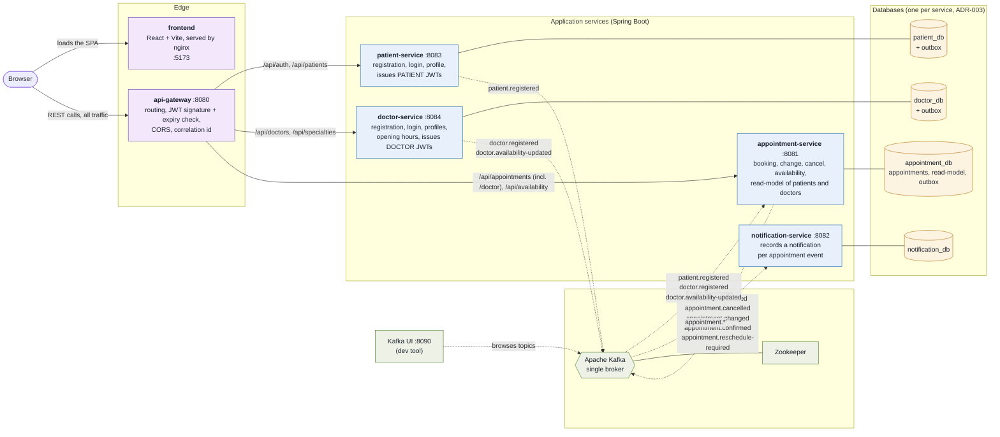
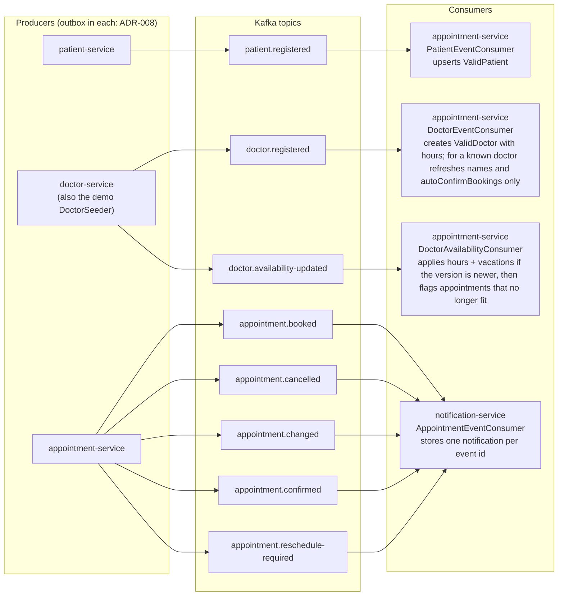
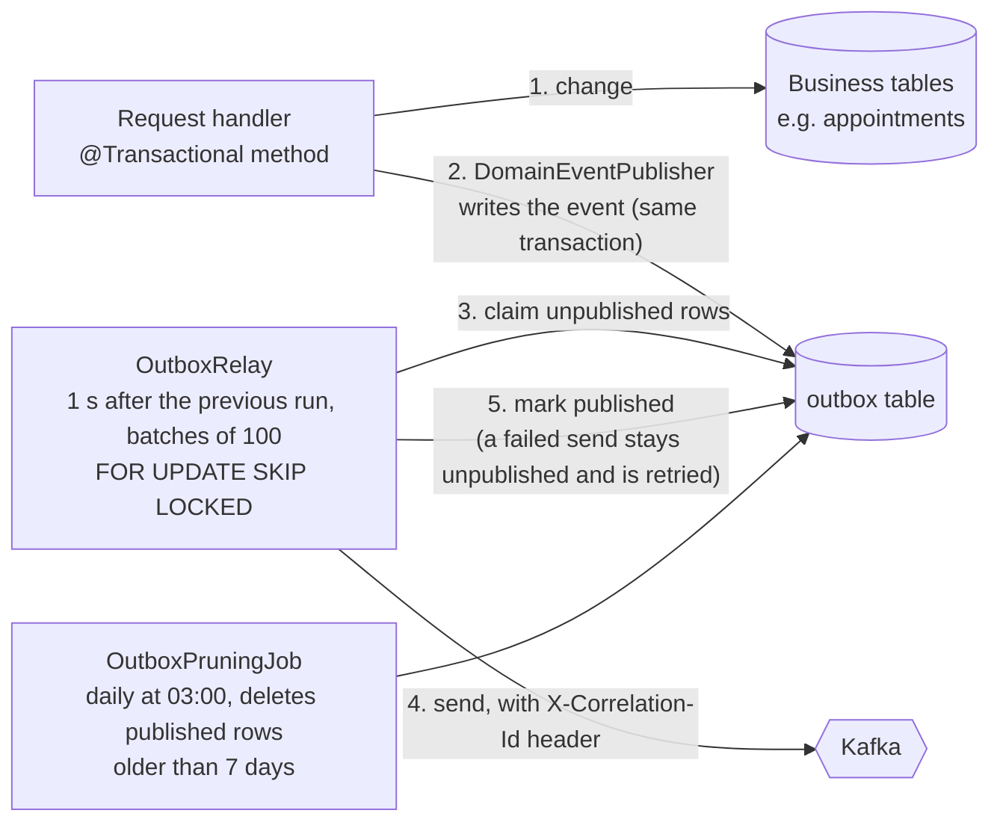
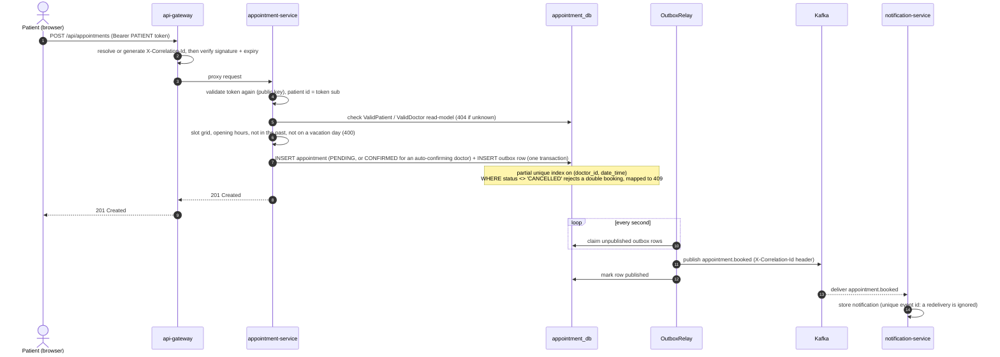
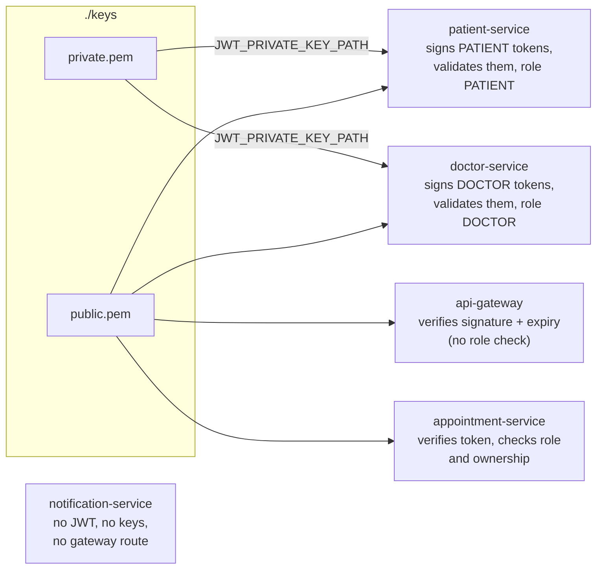

# Architecture

Diagrams of the system as it runs from `docker-compose.yml`. They are Mermaid, so GitHub renders them and they
live next to the code. Each diagram states what the code does today; planned work is called out separately.
When behavior changes, update the diagram in the same PR (see the repo's `CLAUDE.md`).

Contents:

1. [System overview](#1-system-overview): who talks to whom, and what each service owns
2. [Event flow](#2-event-flow): topics, the outbox, and consumers
3. [Booking sequence](#3-booking-sequence): one booking from click to notification
4. [Authentication and key distribution](#4-authentication-and-key-distribution)
5. [Gateway routes](#5-gateway-routes)
6. [Not yet in the diagrams](#6-not-yet-in-the-diagrams)

---

## 1. System overview

**How to read it.** Solid arrows are synchronous HTTP (or a service's own database). Dotted arrows are
asynchronous Kafka events. No service calls another service directly: cross-service data moves only as events
(ADR-002, ADR-005). The frontend calls only the gateway. For local development, compose also publishes each
service's port, the databases and Kafka on the host, so a direct call can skip the gateway, though not the
service's own token check. Service addresses are static (ADR-006).

---

## 2. Event flow

Every event is written to an `outbox` table in the same transaction as the change it describes. A scheduled relay
publishes it to Kafka afterwards (ADR-008). Delivery is at-least-once, so consumers deduplicate (ADR-009).

### Inside a producing service

| Event                   | Producer            | Consumer(s)                      | Effect at the consumer                                     |
|-------------------------|---------------------|----------------------------------|------------------------------------------------------------|
| `patient.registered`    | patient-service     | appointment-service              | Upsert `ValidPatient` (read-model, ADR-005)                |
| `doctor.registered`     | doctor-service      | appointment-service              | Create `ValidDoctor` with its hours; for a known doctor refresh the names and `autoConfirmBookings` only (read-model) |
| `doctor.availability-updated` | doctor-service | appointment-service          | Replace the hours and vacations when the `version` is newer, then flag the booked appointments that no longer fit |
| `appointment.booked`    | appointment-service | notification-service             | Store a notification, deduplicated by event id             |
| `appointment.cancelled` | appointment-service | notification-service             | Same                                                       |
| `appointment.changed`   | appointment-service | notification-service             | Same                                                       |
| `appointment.confirmed` | appointment-service | notification-service             | Same                                                       |
| `appointment.reschedule-required` | appointment-service | notification-service | Same (the patient is asked to reschedule or cancel)    |

---

## 3. Booking sequence

The doctor then confirms, cancels or changes the appointment through `/api/appointments/doctor`, each publishing its own event the
same way. When the doctor changes the opening hours or a vacation in doctor-service, `doctor.availability-updated` reaches
appointment-service, which flags the booked appointments that no longer fit and publishes `appointment.reschedule-required`.

If Kafka is down, the booking still succeeds; the event waits in the outbox and the relay sends it when Kafka
returns. If notification-service is down, Kafka retains the event and the consumer resumes from its last offset.

---

## 4. Authentication and key distribution

Arrows show which key each service is configured to load (`JWT_PRIVATE_KEY_PATH`, `JWT_PUBLIC_KEY_PATH` in
`docker-compose.yml`).

Tokens are RS256 JWTs with the claims `sub`, `role`, `iat` and `exp` (ADR-004). Only patient-service and
doctor-service are configured with the private key, so only they sign tokens; the gateway and appointment-service
are configured with the public key only. Compose mounts the whole `./keys` directory read-only at `/run/keys` into all
four services, though, so `private.pem` is also readable inside the gateway and appointment-service containers. ADR-004 says the
gateway must never have the private key mounted; the compose file does not follow that yet.

Validation is layered: the gateway rejects unauthenticated traffic on protected paths at the edge, and every
service that serves protected endpoints validates the token itself, because the service is the authoritative
boundary.

---

## 5. Gateway routes

| Path prefix                                      | Target service      | Public at the gateway (no token)                         |
|--------------------------------------------------|---------------------|----------------------------------------------------------|
| `/api/auth/**`                                   | patient-service     | `POST /api/auth/register`, `POST /api/auth/login`        |
| `/api/patients/**`                               | patient-service     | none                                                     |
| `/api/doctors/**`                                | doctor-service      | `POST /api/doctors/register`, `POST /api/doctors/login`, every `GET` |
| `/api/specialties/**`                            | doctor-service      | every `GET`                                              |
| `/api/availability/**`                           | appointment-service | every `GET`                                              |
| `/api/appointments/**`                           | appointment-service | none (every request needs a PATIENT token)               |
| `/docs/{appointment,patient,doctor}/v3/api-docs` | each service        | `GET` (feeds the gateway's Swagger UI; these routes exist only while `SWAGGER_ENABLED` is true) |

The gateway also lets these through without a token: CORS preflight (`OPTIONS /**`), `/actuator/health`, its own
Swagger UI (`/swagger-ui/**`, `/swagger-ui.html`, `/v3/api-docs/swagger-config`) and `/error`. Every other request
needs a token with a valid signature and expiry (`anyRequest().authenticated()` in the gateway's `SecurityConfig`).
`notification-service` has no gateway route.

---

## 6. Not yet in the diagrams

These are planned (README, Project Phases) and are deliberately not drawn as if they existed:

* Consumer failure handling from ADR-009: poison-pill handling (`ErrorHandlingDeserializer`), a configured retry
  policy and a dead-letter topic. No consumer configures an error handler today.
* Metrics and distributed tracing (correlation ids are implemented, spans are not)
* Event versioning
* Dynamic service discovery (static per ADR-006)
* Doctor credential verification and a proper onboarding flow
* AI-assisted symptom-to-specialty triage
