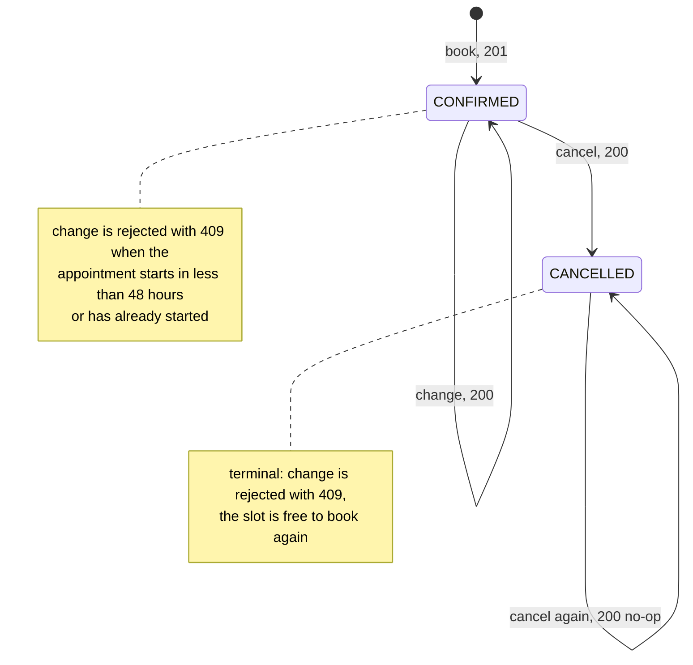

# Domain

The business domain as the code implements it today, plus the rules the
product owner has confirmed but the code does not enforce yet. It is derived
from the code and its tests, not from the README.

- Section 3.1 lists the rules the code enforces. Section 3.2 lists the
  confirmed rules it does not (yet), each with its status and issue.
- When the code and section 3.1 disagree, the code wins and this document is
  wrong. Section 3.2 is the intended behaviour: when the code disagrees with
  it, the code is the one to fix.
- Changes to this document need the user's approval or an approved spec that
  describes them (`.claude/rules/definition-of-done.md`).

Conventions used below:

- `BR-nn` ids are stable. Never renumber or reuse one; retire a rule by
  marking it removed. Add new rules at the end.
- Test references are `Class#method`. The class lives in the service named
  in the "Enforced by" column, or in appointment-service when unprefixed.
  Other services are written as `patient:`, `doctor:` or `notification:`.
  A cell that says **no test found** is a gap in the test suite, not a
  claim that the rule is untested by design.
- Status codes are the HTTP statuses the service returns. Errors raised by
  the services are RFC 9457 problem details; the quoted title is the problem
  `title`. A 401 or 403 from the security filter (missing or invalid token,
  wrong role) has no problem body.

## 1. Glossary

| Term | Meaning |
|---|---|
| Patient | A registered user (patient-service) with username, email, date of birth and insurance type. Authenticates with a JWT whose `role` is `PATIENT` and whose subject is the patient id. Only patients can book, change, cancel or list appointments. |
| Doctor | A practitioner (doctor-service) registered with email, address, specialties, languages and opening hours. Authenticates with a JWT whose `role` is `DOCTOR`. A doctor can call no endpoint under `/api/appointments`. |
| Specialty | A named medical field (e.g. "Cardiology"); a doctor has one or more, and doctors are searched by exact specialty name. |
| Opening hours | A doctor's weekly blocks of (weekday, start, end); a day can have several blocks, which must not overlap and must start and end on the hour or half hour. |
| Slot | A 30-minute interval that starts on the hour or half hour and lies fully inside one opening-hours block of a doctor. It has no table of its own: it is the pair (doctor, start time). |
| Appointment | A patient's reservation of one slot with one doctor, with a type, optional notes (max 500 characters), a fixed 30-minute duration and a status of `CONFIRMED` or `CANCELLED` (`PENDING` exists but is reserved, see section 5). |
| Appointment type | Why the patient comes: `INITIAL_CONSULTATION`, `FOLLOW_UP` or `VACCINATION`. |
| Insurance type | `PRIVATE` or `STATUTORY`, chosen at patient registration and returned in the patient's profile, kept for the doctor to see; no rule reads it today. |
| Read model | appointment-service's own copy of the doctors (id, name, opening hours) and patients (id, name, email) it needs, filled from the `doctor.registered` and `patient.registered` events. Booking and availability check it instead of calling the other services. |

## 2. Appointment lifecycle

`PENDING` exists in the `AppointmentStatus` enum but no code path sets it
(reserved, see section 5), so it is not a state in the diagram.

The diagram and table show what the code does today. Confirmed changes that
are not implemented yet: cancelling will need the same notice as changing
(BR-22), a patient will not be able to hold two appointments at the same
time (BR-25), the notice for changing will not apply to a change of the
notes only (BR-32), and cancel and change will require the patient in the read
model, as booking does (BR-33).

Transitions that exist, and what is rejected on each:

| Action | From | To | Success | Rejected with |
|---|---|---|---|---|
| Book | (none) | `CONFIRMED` | 201 | 400 request invalid (BR-15), slot not aligned (BR-01), outside opening hours (BR-03), in the past (BR-05); 401/403 wrong token (BR-10); 404 patient or doctor unknown (BR-16); 409 slot taken (BR-07) |
| Change (type, time or notes) | `CONFIRMED` | `CONFIRMED` | 200 | 400 empty or invalid body (BR-14), new time not aligned, outside hours or in the past (BR-01, BR-03, BR-05); 401/403 (BR-10, BR-09); 404 appointment or, when the time changes, doctor unknown (BR-16); 409 cancelled (BR-12), inside the 48-hour notice (BR-13), new slot taken (BR-07); 503 row locked for more than 3 seconds (BR-11) |
| Cancel | `CONFIRMED` | `CANCELLED` | 200 | 401/403 (BR-10, BR-09); 404 appointment unknown; 503 row locked for more than 3 seconds |
| Cancel again | `CANCELLED` | `CANCELLED` | 200, nothing saved, no event (BR-11) | 403 when the appointment is someone else's (BR-09) |
| Change | `CANCELLED` | (none) | - | 409 "Appointment Not Changeable" (BR-12) |

Checks run in this order, so the first failing one decides the status:

- Book: token (401/403), body validation (400), patient (404), doctor
  (404), booking rules (400: alignment, then opening hours, then past),
  insert (409 if the slot is taken).
- Change: token, body validation, appointment (404), owner (403),
  cancelled (409), notice window (409), then, only if the time differs from
  the stored one, doctor (404) and the booking rules (400), then update
  (409 if the slot is taken).
- Cancel: token, appointment (404), owner (403), then cancel or no-op.

A booked, changed or cancelled appointment publishes `appointment.booked`,
`appointment.changed` or `appointment.cancelled` in the same transaction.
Change publishes only when the type or time actually changed.

## 3. Business rules

### 3.1 Implemented

Every rule in this table is enforced by the code today.

| ID | Rule | Enforced by | Covered by |
|---|---|---|---|
| BR-01 | Slot grid: a start time must be on the hour or half hour with zero seconds and nanos, otherwise 400 "Slot Not Aligned". Applies to booking and to a changed time. | `SlotAlignedRule`, `SlotPolicy#isAligned` | `BookingRulesTest#slotAligned_onGrid_shouldPass`, `#slotAligned_offGrid_shouldThrowSlotNotAligned` `SlotPolicyTest#isAligned_onTheHourAndHalfHour_shouldBeTrue`, `#isAligned_offGridMinuteSecondOrNano_shouldBeFalse` `AppointmentServiceUpdateTest#updateAppointment_newTimeNotOnTheSlotGrid_throwsSlotNotAligned` `AppointmentUpdateEndpointTest#updateAppointment_slotNotAligned_returns400` |
| BR-02 | Slot length: every appointment lasts 30 minutes. The client cannot send a duration; the service sets it. | `SlotPolicy#SLOT_DURATION_MINUTES`, `AppointmentService#bookAppointment` | `AppointmentServiceTest#bookAppointment_shouldSetDurationToThirtyServerSide` `SlotPolicyTest#slotEnd_shouldBeThirtyMinutesAfterStart` |
| BR-03 | Opening hours: the whole slot (start to start + 30 min) must lie inside one opening-hours block of the doctor on that weekday. A slot ending exactly at closing time fits; one starting at closing time does not. Otherwise 400 "Outside Opening Hours". | `WithinOpeningHoursRule`, `ValidDoctor#isOpenFor`, `OpeningHours#covers` | `BookingRulesTest#withinOpeningHours_lastSlotEndingAtClosing_shouldPass`, `#withinOpeningHours_atClosingOrOnClosedDay_shouldThrowOutsideOpeningHours` `ValidDoctorTest#openingHoursCovers_shouldIncludeBothBoundaries`, `#isOpenFor_slotInsideAnyBlockOfThatDay_shouldBeTrue`, `#isOpenFor_slotInLunchGapOrOnAnotherDay_shouldBeFalse` `AppointmentServiceUpdateTest#updateAppointment_newTimeOneSlotBeforeOpening_throwsOutsideOpeningHours`, `#updateAppointment_newTimeStartsAtClosingTime_throwsOutsideOpeningHours` `AppointmentChangeIntegrationTest#changeAppointment_outsideOpeningHours_returns400` |
| BR-04 | A doctor's opening hours are well formed when the doctor registers: at least one block, start before end, both on the hour or half hour, and no overlapping blocks on the same day (back-to-back blocks are fine). Otherwise 400. This keeps the blocks aligned with BR-01. | doctor: `OpeningHoursValidator`, `DoctorRegistrationRequest#openingHours` | doctor: `OpeningHoursValidatorTest#overlappingBlocksSameDay_areInvalid`, `OpeningHoursValidatorTest#backToBackBlocksSameDay_areValid`, `OpeningHoursValidatorTest#startOffHalfHourGrid_isInvalid`, `OpeningHoursValidatorTest#startTimeAfterEndTime_isInvalid` doctor: `DoctorIntegrationTest#register_overlappingOpeningHours_returns400WithOverlapError`, `#register_offGridOpeningHours_returns400WithGridError`, `#register_backToBackOpeningHours_returns201` |
| BR-05 | Not in the past: a slot starting before now is rejected with 400 "Slot In The Past". A slot starting exactly now is accepted. Applies to booking and to a changed time (not to the old time of a change; see BR-13). | `NotInPastRule` (uses the injected `Clock`) | `BookingRulesTest#notInPast_slotBeforeNow_shouldThrowSlotInPast`, `#notInPast_slotExactlyNowOrLater_shouldPass` `AppointmentServiceTest#bookAppointment_slotInThePast_shouldThrowSlotInPastAndNotSaveOrPublish` `AppointmentErrorMappingTest#bookAppointment_slotInPast_returns400WithSlotInPastProblemDetail` `AppointmentIntegrationTest#createAppointment_pastSlot_returns400SlotInThePast` `AppointmentServiceUpdateTest#updateAppointment_newTimeOneSlotBeforeNow_throwsSlotInPast`, `#updateAppointment_newTimeExactlyNow_isAccepted` |
| BR-06 | The booking rules run in a fixed order: alignment (BR-01), then opening hours (BR-03), then not-in-past (BR-05). The first failure decides the error. | `@Order(1..3)` on the `BookingRule` beans | `BookingRulesTest#ruleOrder_shouldCheckAlignmentThenOpeningHoursThenNotInPast` |
| BR-07 | No double booking: a doctor has at most one non-cancelled appointment per start time, whoever books. A cancelled appointment frees its slot. Losing the race returns 409 "Slot Already Booked" for both booking and change. The service maps any `DataIntegrityViolationException` from that insert or update to this 409, not only a violation of the index. | Partial unique index `ux_active_appointment` on `appointments (doctor_id, date_time) WHERE status <> 'CANCELLED'` (appointment `schema-postgresql.sql`); `AppointmentService` turns the `DataIntegrityViolationException` from `saveAndFlush` into `SlotAlreadyBookedException` | `AppointmentIntegrationTest#createAppointment_concurrentUsers_returnStatus409` `AppointmentServiceTest#bookAppointment_slotAlreadyTakenAtSaveTime_shouldThrowSlotAlreadyBookedExceptionAndNotPublishEvent` `AppointmentServiceUpdateTest#updateAppointment_newTimeAlreadyTaken_throwsSlotAlreadyBookedAndPublishesNothing` `AppointmentChangeIntegrationTest#changeAppointment_slotTakenByAnotherPatient_returns409AndKeepsTheOldTime`, `#changeAppointment_concurrentMovesToTheSameSlot_oneSucceedsTheRestGet409` **no test found** that a cancelled appointment's slot can be booked again |
| BR-08 | Availability: the free slots of a doctor on a date are the aligned 30-minute slots of that weekday's opening-hours blocks whose full slot ends by closing time, minus slots held by non-cancelled appointments, and, for today, minus slots that started before now. A date before today returns an empty list (200). An unknown doctor is 404. | `AvailabilityService#getAvailableSlots`, `SlotPolicy#slotsWithin` | `AvailabilityServiceTest#getAvailableSlots_gridBoundaries_shouldReturnExactThirtyMinuteSlotsWithinOpeningHours`, `#getAvailableSlots_splitShift_shouldSkipLunchGapAndReturnBothBlocks`, `#getAvailableSlots_takenAppointment_shouldExcludeOnlyThatSlot`, `#getAvailableSlots_today_shouldDropSlotsThatStartedBeforeNow`, `#getAvailableSlots_today_slotStartingExactlyNow_shouldBeKept`, `#getAvailableSlots_dateBeforeToday_shouldReturnNoSlots`, `#getAvailableSlots_unknownDoctor_shouldThrowDoctorNotFoundException` `SlotPolicyTest#slotsWithin_shouldStartAtOpeningAndEndOneSlotBeforeClosing`, `#slotsWithin_offGridStart_shouldStartAtNextAlignedSlot`, `#slotsWithin_offGridEnd_shouldStopAtLastSlotEndingBeforeClosing` `AvailabilityIntegrationTest#getAvailability_excludesBookedSlot_includesAdjacentSlots` **no test found** that a cancelled appointment's slot is offered again |
| BR-09 | Ownership: the patient id always comes from the token subject, never from a request body. A patient can cancel, change and list only their own appointments, and read only their own profile. Someone else's appointment is 403 "Not Resource Owner"; the owner check comes before the cancelled check and the repeat-cancel no-op. | `AppointmentService#bookAppointment`, `#cancelAppointment`, `#updateAppointment`, `#getAppointmentsForPatient` (filters by patient id); `PatientService#getPatientProfileById` | `AppointmentServiceTest#bookAppointment_shouldSetPatientIdFromTokenParameterNotFromMappedRequest`, `#cancelAppointment_mismatchedPatientId_shouldThrowAccessDeniedAndNotCancelOrSave`, `#cancelAppointment_alreadyCancelledOwnedBySomeoneElse_shouldThrowAccessDenied` `AppointmentIntegrationTest#cancelAppointment_notOwner_returns403` `AppointmentServiceUpdateTest#updateAppointment_otherPatientsAppointment_throwsAccessDeniedAndChangesNothing` `AppointmentChangeIntegrationTest#changeAppointment_notOwner_returns403AndChangesNothing` `AppointmentControllerTest#getMyAppointments_patientToken_shouldReturn200WithPatientIdFromTokenSubject` patient: `PatientServiceTest#getPatientProfileById_requesterIdMismatch_throwsPatientAccessDeniedException` **no test found** that the list query returns only the caller's rows (the service test mocks the repository) |
| BR-10 | Role: the appointment API requires a valid token with role `PATIENT` (no or invalid token 401, doctor token 403). Browsing doctors, specialties and availability is public. | appointment `SecurityConfig` (`anyRequest().hasRole("PATIENT")`, `GET /api/availability/**` permitted); the public doctor and specialty reads are permitted in the doctor `SecurityConfig` (`GET /api/doctors/**`, `GET /api/specialties/**`) and in the api-gateway `SecurityConfig` | `AppointmentSecurityTest#bookAppointment_doctorToken_returns403`, `#getMyAppointments_doctorToken_returns403`, `#cancelAppointment_doctorToken_returns403` `AppointmentIntegrationTest#createAppointment_doctorToken_returns403`, `#createAppointment_signWithUntrustedKeypair_returns401` `AppointmentUpdateEndpointTest#updateAppointment_noToken_returns401`, `#updateAppointment_doctorToken_returns403` doctor: `DoctorControllerTest#getDoctorById_existingId_returns200WithBody`, `#findDoctors_noFilters_returns200` (no token) gateway: `GatewaySecurityTest#publicPath_noAuthorization_isNotRejectedByEdgeSecurity`, `#protectedPath_noAuthorization_returns401` `AvailabilityControllerTest#getAvailability_validRequest_shouldReturn200WithMockedBodyAndParsedDate`, `AvailabilityIntegrationTest#getAvailability_excludesBookedSlot_includesAdjacentSlots` (no token) |
| BR-11 | Repeat cancel: cancelling an already-cancelled appointment returns 200 with the current state, saves nothing and publishes no second event. Cancel and change take a row lock on the appointment (`findByIdForUpdate`), which serialises concurrent calls; if the lock is not granted within 3 seconds the answer is 503 "Appointment Busy" with `Retry-After: 1`, and retrying is safe. | `AppointmentService#cancelAppointment`, `AppointmentRepository#findByIdForUpdate` | `AppointmentServiceTest#cancelAppointment_alreadyCancelledAppointment_shouldReturnCurrentStateWithoutSavingOrPublishing` `AppointmentIntegrationTest#cancelAppointment_calledTwice_secondCallIsNoOpAndPublishesOneEvent`, `#cancelAppointment_concurrentCalls_allReturn200AndPublishOneEvent`, `#cancelAppointment_rowHeldByAnotherTransaction_returns503ThenSucceedsOnceReleased` `AppointmentCancelErrorResponseTest#cancelAppointment_lockNotAcquired_returns503WithRetryAfter` `AppointmentChangeIntegrationTest#changeAppointment_rowHeldByAnotherTransaction_returns503ThenSucceedsOnceReleased`, `AppointmentUpdateEndpointTest#updateAppointment_lockWaitTimesOut_returns503WithRetryAfter` |
| BR-12 | A cancelled appointment cannot be changed: 409 "Appointment Not Changeable". | `AppointmentService#updateAppointment` | `AppointmentServiceUpdateTest#updateAppointment_cancelledAppointment_throwsNotChangeable` `AppointmentUpdateEndpointTest#updateAppointment_cancelledAppointment_returns409NotChangeable` `AppointmentChangeIntegrationTest#changeAppointment_cancelledAppointment_returns409NotChangeable`, `#changeAppointment_racingACancel_neverRevivesTheCancelledAppointment` |
| BR-13 | Change notice: an appointment can be changed only while its current start is at least `appointment.change.min-notice-hours` (default 48) after now; exactly 48 hours is allowed. This is checked against the old start, for every kind of change including notes only (BR-32 will exempt notes-only changes); the new time only has to satisfy BR-01, BR-03 and BR-05. Otherwise 409 "Change Window Closed". Cancelling has no such window today (BR-22). | `ChangePolicyProperties`, `AppointmentService#updateAppointment` | `AppointmentServiceUpdateTest#updateAppointment_startsExactlyAtMinimumNotice_isAllowed`, `#updateAppointment_startsOneMinuteInsideMinimumNotice_throwsChangeWindowClosed`, `#updateAppointment_alreadyStarted_throwsChangeWindowClosed`, `#updateAppointment_configuredNoticeOfSixHours_allowsAppointmentSevenHoursAway` `AppointmentUpdateEndpointTest#updateAppointment_insideNoticePeriod_returns409ChangeWindowClosed` `AppointmentChangeIntegrationTest#changeAppointment_startsInLessThan48Hours_returns409ChangeWindowClosed` |
| BR-14 | Change request: partial update of type, dateTime and notes; at least one must be present (400 otherwise); notes at most 500 characters, and an empty string clears them. Doctor, patient, duration and status never change. Booking rules re-run only when the time differs from the stored one. An event is published only when the type or time changed (a notes-only or no-op change publishes nothing). | `AppointmentUpdateRequest`, `AppointmentService#updateAppointment` | `AppointmentUpdateEndpointTest#updateAppointment_emptyObject_returns400`, `#updateAppointment_notesOf500Characters_isAccepted`, `#updateAppointment_notesOf501Characters_returns400`, `#updateAppointment_emptyNotesAlone_isAccepted`, `#updateAppointment_unknownType_returns400`, `#updateAppointment_malformedDateTime_returns400` `AppointmentServiceUpdateTest#updateAppointment_emptyNotes_clearsNotes`, `#updateAppointment_notesOnly_savesNotesAndPublishesNoEvent`, `#updateAppointment_sameTimeAndType_publishesNoEventAndSkipsDoctorLookup`, `#updateAppointment_typeAndTime_appliesBoth` `AppointmentChangeIntegrationTest#changeAppointment_emptyBody_returns400`, `#changeAppointment_notesOnly_publishesNoEvent` |
| BR-15 | Booking request: `doctorId`, `dateTime` and `type` are required; notes at most 500 characters. Otherwise 400 "Validation Error". | `AppointmentRequest` (`@NotNull`, `@Size`), `GlobalExceptionHandler` | **no test found** |
| BR-16 | Read-model existence: booking needs both the patient and the doctor in the read model (else 404 "Patient Not Found" / "Doctor Not Found"); availability needs the doctor; a change needs the doctor only when the time changes. Nothing is asked of patient-service or doctor-service at request time, so a patient or doctor who registered a moment ago can briefly get 404 until their event is processed. Each event overwrites the stored row for its id, so a re-delivered identical event leaves the projection unchanged. | `AppointmentService`, `AvailabilityService`, `DoctorEventConsumer`, `PatientEventConsumer` | `AppointmentServiceUpdateTest#updateAppointment_doctorMissingFromReadModel_throwsDoctorNotFound` `AppointmentUpdateEndpointTest#updateAppointment_doctorUnknown_returns404` `AvailabilityServiceTest#getAvailableSlots_unknownDoctor_shouldThrowDoctorNotFoundException` `ReadModelProjectionIntegrationTest#patientRegisteredEvent_consumed_createsValidPatientProjection`, `#doctorRegisteredEvent_consumed_createsValidDoctorProjection`, `#doctorRegisteredEvent_redelivered_leavesOpeningHoursUnchanged`, `#patientRegisteredEvent_redelivered_leavesProjectionUnchanged` **no test found** for the 404 on booking with an unknown patient or doctor |
| BR-17 | Password: patients and doctors share one rule, at least 8 characters and at most 72 bytes in UTF-8 (400 with a `password` field error otherwise). Both are stored only as a BCrypt hash. Login only requires a non-blank password, so older, shorter passwords still work, but it refuses one over 72 bytes (BR-18). | patient: `RegisterRequest#password` (`@NotBlank`, `@ValidPassword`), `AuthService`; doctor: `DoctorRegistrationRequest#password` (`@NotBlank`, `@ValidPassword`), `DoctorAuthService`; `PasswordValidator` in each service | patient: `AuthControllerTest#register_passwordTooShort_returns400WithPasswordError`, `#register_passwordExactlyMinimumLength_returns201`, `#register_passwordTooLong_returns400WithPasswordError`, `#register_passwordExactlyMaximumLength_returns201`, `#register_blankPassword_returns400WithPasswordError`, `#register_passwordWithinCharacterLimitButOver72Bytes_returns400WithPasswordError`, `#register_passwordExactly72BytesOfMultiByteCharacters_returns201` patient: `PasswordRuleTest` patient: `AuthServiceTest#register_passwordIsStoredAsHash_notPlaintext` doctor: `DoctorAuthServiceTest#register_passwordIsStoredAsHash_notPlaintext` doctor: `PasswordRuleTest`, `DoctorRegisterPasswordTest#register_password73Bytes_returns400WithPasswordError`, `#register_password72Bytes_returns201`, `#register_passwordOf37TwoByteCharacters_returns400WithPasswordError`, `#register_passwordOf36TwoByteCharacters_returns201` |
| BR-18 | Login failure: an unknown username (patient) or email (doctor) and a wrong password give the same 401 "Invalid Credentials" with the same message. So does a login password over 72 bytes, for any account, because BCrypt would compare only its first 72 bytes. | patient `AuthService#login`, doctor `DoctorAuthService#login`, `PasswordValidator#fitsEncoder` | patient: `AuthServiceTest#login_unknownUsername_throwsInvalidCredentialsException`, `#login_wrongPassword_throwsInvalidCredentialsException`, `#login_passwordOver72Bytes_throwsInvalidCredentialsExceptionWithoutComparing`, `#login_passwordOfExactly72Bytes_isComparedWithTheEncoder` patient: `AuthIntegrationTest#login_passwordOver72BytesWithRegisteredPrefix_returns401`, `#login_passwordOfExactly72Bytes_returns200`, `PasswordRuleTest#fitsEncoder_isTrueExactlyUpTo72Bytes` doctor: `DoctorAuthServiceTest#login_unknownEmail_throwsInvalidCredentialsException`, `#login_wrongPassword_throwsInvalidCredentialsException`, `#login_passwordOver72Bytes_throwsInvalidCredentialsExceptionWithoutComparing`, `#login_passwordOfExactly72Bytes_isComparedWithTheEncoder` doctor: `DoctorIntegrationTest#login_wrongPassword_returns401`, `#login_unknownEmail_returns401`, `#login_passwordOver72BytesWithRegisteredPrefix_returns401`, `#login_passwordOfExactly72Bytes_returns200`, `PasswordRuleTest#fitsEncoder_isTrueExactlyUpTo72Bytes` |
| BR-19 | Unique identity: a patient's username and email, and a doctor's email, can be registered once (exact string match) or the answer is 409. | patient: unique columns on `Patient`, `AuthService#register`; doctor: unique column on `Doctor`, `DoctorAuthService#register` | patient: `AuthServiceTest#register_userExists_throwsUsernameAlreadyExistsException`, `#register_emailExists_throwsEmailAlreadyExistsException` patient: `AuthIntegrationTest#register_duplicateUsername_returns409AndSingleRow`, `#register_duplicateEmail_returns409AndSingleRow` doctor: `DoctorAuthServiceTest#register_emailAlreadyExists_throwsEmailAlreadyExistsException` doctor: `DoctorIntegrationTest#register_duplicateEmail_returns409AndSingleRow` |
| BR-20 | A doctor registers with at least one specialty, one language and one opening-hours block, and every given specialty id must exist (else 404 and nothing is saved). | doctor: `DoctorRegistrationRequest` (`@NotEmpty`), `DoctorAuthService#register` | doctor: `DoctorAuthServiceTest#register_specialtyNotFound_throwsAndNeverSaves` **no test found** for the empty-set validation |
| BR-21 | A notification is recorded once per event id: a re-delivered `appointment.booked`, `.cancelled` or `.changed` event is ignored, any other failure is rethrown so the message is retried. | notification: `NotificationService#record`, unique index `ux_notification_event_id` | notification: `NotificationServiceTest#record_eventIdAlreadyStored_ignoresTheDuplicateWithoutThrowing`, `#record_otherConstraintViolation_isRethrown`, `#record_databaseUnavailable_isRethrown` notification: `NotificationConsumerIntegrationTest#appointmentChangedEvent_redelivered_writesOnlyOneRow` |
| BR-26 | Patients and doctors share one password rule (BR-17), defined by the same `@ValidPassword` constraint in both services. | `PasswordValidator` in patient-service and doctor-service (duplicated on purpose, kept in sync by hand) | patient and doctor: `PasswordRuleTest` |
| BR-27 | A password the encoder cannot hash (over 72 bytes) is refused with 400 and a `password` field error, for both roles, never 500. The limit is counted in UTF-8 bytes, so 37 two-byte characters are refused. | `PasswordValidator` | patient: `AuthControllerTest#register_passwordWithinCharacterLimitButOver72Bytes_returns400WithPasswordError`, `PasswordRuleTest` doctor: `DoctorRegisterPasswordTest#register_passwordOf37TwoByteCharacters_returns400WithPasswordError`, `PasswordRuleTest` |

### 3.2 Intended, not implemented

Confirmed by the product owner; the code does not enforce them yet. "Today"
is what the code does instead. When a rule is implemented, move it to 3.1
with its enforcing class and tests.

| ID | Rule | Status | Today |
|---|---|---|---|
| BR-22 | Cancel notice: an appointment can be cancelled only while its start is at least the configured minimum notice (the same property and default of 48 hours as BR-13) after now; exactly 48 hours is allowed. Otherwise 409 with its own problem title. A repeat cancel of an already-cancelled appointment stays a 200 no-op (BR-11). | In progress, #102 | Cancelling has no time limit; an appointment that starts in a minute, or already started, can be cancelled. |
| BR-23 | When a cancel or change is refused because of the notice window, the patient is told to contact the clinic and is shown the doctor's phone number, taken from the doctor data (`phoneNumber`). | In progress, #102 | The change pop-up says the appointment can no longer be changed, with no phone number; cancel has no refusal. |
| BR-24 | A successful patient login records the time in `Patient#lastLogin`; a failed login does not change it. | In progress, #103 (PR #108) | `lastLogin` is never written. |
| BR-25 | A patient has at most one non-cancelled appointment per start time, with any doctor, on booking and on change. | Not implemented, #110 | Only the per-doctor index BR-07 exists, so a patient can book the same time with two doctors. |
| BR-28 | All appointment times are interpreted in one defined time zone. | Not implemented, #114 | Times are zone-less `LocalDateTime` values, and "now" is the appointment-service server's default-zone clock (`Clock.systemDefaultZone()`). |
| BR-29 | Usernames and emails are unique, and login finds them, regardless of case. | Not implemented, #115 | Exact string match: `Max` and `max` can both register (BR-19). |
| BR-30 | The appointment read model follows changes to doctors and patients (and removals). | Not implemented, #116 (overlaps #101) | Written only from `doctor.registered` and `patient.registered`; each event overwrites the row for its id (BR-16). |
| BR-31 | A doctor can see and manage their own appointments and availability, in a doctor-specific UI separate from the patient UI. | Not implemented, #101 | The appointment API admits only patients (BR-10); doctors can change nothing after registering; both roles share one toolbar. |
| BR-32 | The change notice (BR-13) applies only to a change of type or time. A change of the notes only is allowed inside the window, on an appointment that is not cancelled (BR-12) and is the caller's own (BR-09). | Not implemented, #117 (bug) | The notice check runs before the fields are looked at, so a notes-only change inside 48 hours, or after the start, is refused with 409 "Change Window Closed"; the frontend shows the "can no longer be changed" pop-up instead of the form. |
| BR-33 | Cancel and change require the patient in the read model, as booking does (BR-16): an unknown patient gets 404 "Patient Not Found". | Not implemented, #113 | Cancel and change use the token subject only and never look the patient up. |

## 4. Use cases

All requests go through the api-gateway under the same paths. The gateway
rejects a missing or invalid token on protected paths with 401 before the
request reaches a service.

| Use case | Actor | Endpoint | Main flow | Can be rejected by |
|---|---|---|---|---|
| Register (patient) | Visitor | `POST /api/auth/register` (patient-service) | Validates the body, hashes the password, saves the patient and queues `patient.registered` in the same transaction, then returns 201 with a JWT (role `PATIENT`, subject = patient id, valid 3600 s). The patient is logged in straight away. | BR-17, BR-19; other fields (names, email format, date of birth, insurance type) give 400 |
| Register (doctor) | Visitor | `POST /api/doctors/register` (doctor-service) | Validates the body, resolves the specialty ids, hashes the password, saves the doctor and queues `doctor.registered` with the opening hours, then returns 201 with a JWT (role `DOCTOR`). | BR-04, BR-17, BR-19, BR-20 |
| Log in (patient / doctor) | Patient / doctor | `POST /api/auth/login` (username + password) / `POST /api/doctors/login` (email + password) | Looks the account up, compares the BCrypt hash, returns 200 with a JWT. | BR-18; a doctor login with a malformed email or a blank field gives 400 before the credential check |
| Browse doctors and availability | Anyone, no token | `GET /api/specialties`, `GET /api/doctors?specialty=&language=`, `GET /api/doctors/{id}`, `GET /api/availability?doctorId=&date=` | Lists specialties, filters doctors by exact specialty name and/or language, shows one doctor's profile, and lists the free slots of one doctor on one date. | BR-08 (availability); unknown doctor id 404, unknown language or malformed parameter 400 |
| Book | Patient | `POST /api/appointments` | Takes the patient from the token, sets duration 30 and status `CONFIRMED`, runs the booking rules against the doctor's read model, inserts, queues `appointment.booked`, returns 201 with the appointment. | BR-10, BR-15, BR-16, BR-01, BR-03, BR-05 (in the order of BR-06), BR-07; planned: BR-25 |
| Change | Patient | `PATCH /api/appointments/{id}` | Locks the appointment row, checks owner, status and notice, optionally moves it to a new free slot, updates type and notes, queues `appointment.changed` if type or time changed, returns 200. | BR-10, BR-14, BR-09, BR-12, BR-13, BR-16, BR-01, BR-03, BR-05, BR-07, BR-11 (lock timeout, 503); planned: BR-25, BR-33 |
| Cancel | Patient | `PUT /api/appointments/{id}/cancel` | Locks the appointment row, checks the owner, sets status `CANCELLED`, queues `appointment.cancelled`, returns 200. A repeat returns 200 unchanged. | BR-10, BR-09, BR-11 (lock timeout, 503; a repeat cancel is a no-op, not a rejection); planned: BR-22, BR-33 |
| View my appointments | Patient | `GET /api/appointments` | Returns the caller's appointments ordered by start time, ascending, including cancelled ones. | BR-10 |
| View my profile | Patient | `GET /api/patients/{id}` (patient-service) | Returns the profile when the id is the caller's own. | BR-10 (patient-service `SecurityConfig`), BR-09 |
| Notification | System (Kafka consumers in notification-service) | none; no endpoint exposes notifications | Consumes `appointment.booked`, `appointment.cancelled` and `appointment.changed` and stores one `Notification` row each, with the message "Appointment booked for / cancelled for / changed to" plus the appointment time. | BR-21 (a duplicate is ignored, not an error) |

## 5. Deliberate for now, and open decisions

Not rules and not bugs: what the code does on purpose for now, and what is
still to be decided. Everything confirmed as a defect or a missing rule is in
section 3.2.

Deliberate for now:

1. **`PENDING` is never set.** The `AppointmentStatus` enum and the frontend
   type list it, but booking sets `CONFIRMED` directly. Kept for the
   doctor's view of appointments (BR-31); no behaviour is attached to it yet.
2. **Insurance type and date of birth affect nothing.** They are stored and
   returned in the patient's profile so a doctor can see them (BR-31); no
   rule, event or notification reads them.
3. **Cancel and change answer 404 for an unknown id and 403 for someone
   else's appointment.** This tells a caller that an id exists. Appointment
   ids are random UUIDs, so there is nothing to enumerate, and a clear 403
   is more useful to the frontend, so BR-09 keeps it.

Open decisions:

4. **Whether the list requires the patient read model** (#113). Cancel and
   change will require it (BR-33). `GET /api/appointments` does not today: a
   token for a patient unknown to appointment-service gets an empty list.
   Not decided; it stays as it is until it is.
